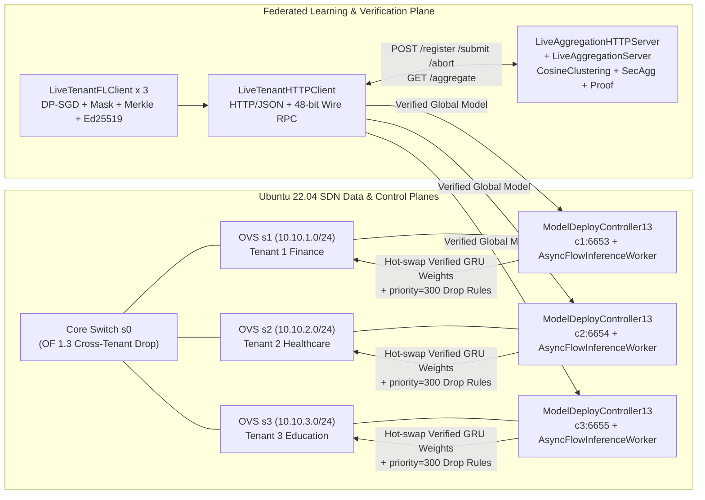

# TrustFed-SDN Live End-to-End Integration Pipeline (`docs/LIVE_PIPELINE.md`)

> Step 08 — Live Integration on the SDN Testbed | Design choices recorded in [`docs/USER_PREFERENCES.md`](USER_PREFERENCES.md) and [`docs/DEVIATIONS.md`](DEVIATIONS.md) (`DEV-003`) | Results logged in [`docs/EXPERIMENT_RESULTS_LOG.md`](EXPERIMENT_RESULTS_LOG.md) (Section 9).

---

## 1. End-to-End System Architecture

TrustFed-SDN integrates multi-tenant federated training (`testbed/fl/`) directly with per-tenant OpenFlow 1.3 SDN controllers (`testbed/ryu_apps/model_deploy.py`) over the `L1` Ubuntu 22.04 + Mininet `2.3.0` + Open vSwitch `2.17.12` + OS-Ken `3.0.1` testbed (`10.10.0.0/16`):



---

## 2. Implemented Live Modules & Key Classes

### 2.1 Live Tenant FL Client (`testbed/fl/tenant_client.py`)
- **`load_live_tenant_splits`:** Loads the `4,392` real testbed flows (`data/live/live_flows_insdn.csv`, `19` Step 01 features) per tenant (`tenant_1_finance`, `tenant_2_healthcare`, `tenant_3_education`) using deterministic `70% / 10% / 20%` stratified splits and global standardization fitted only on training splits.
- **`build_live_gru`:** Instantiates `GRUClassifier` with the Step 02/05 approved `seq_mode="single_step"`, `num_chunks=1`, `dropout=0.0` configuration (`43,554` trainable scalar parameters across `14` parameter tensors for `InSDN` `19` features).
- **`LiveTenantFLClient`:**
  - Runs local **record-level DP-SGD** (`dp_batch_size=64`, `dp_max_grad_norm=0.5`) with adaptive hybrid-sensitivity privacy allocation across the 3 tenants (final achieved `12`-round budgets at `delta=1e-5`: `tenant_1_finance=4.2613`, `tenant_2_healthcare=3.4774`, `tenant_3_education=4.2613`).
  - Quantizes updates (`20-bit` fixed-point), applies pairwise `X25519` + `SHAKE-256` additive masking mod `2^48` (`6 bytes/param`), builds dual-prime (`p_1 = 2^31 - 1`, `p_2 = 2^31 - 19`) linear homomorphic checksums + `SHA-256` Merkle leaf commitments, signs with `Ed25519` + replay round counter, and verifies every downloaded aggregate before updating local/controller weights.
  - Supports configurable poisoning modes (`scaling`, `sign_flip`) for live adversarial validation.

### 2.2 Live Verification & Screening Coordinator (`testbed/fl/aggregation_server.py`)
- **`LiveAggregationServer` & `LiveAggregationOutcome`:** Bridges `SecureAggregator` (`trustfed/aggregation/secure.py`) with HTTP round orchestration.
  - Verifies pairwise mask cancellations, tenant signatures, and replay nonces.
  - Screens anomalous updates via Step 04 **`CosineClusteringAggregator`** (adaptive rejection when pairwise cosine distances separate an adversarial cluster).
  - Unmasks accepted updates, generates the `SHA-256` Merkle tree root + inclusion proofs (`VerificationProof`), and records full per-round provenance (`accepted_clients`, `rejected_clients`).

### 2.3 HTTP/JSON + 48-Bit Packed Wire RPC Service (`testbed/fl/protocol_http.py`)
- **`LiveAggregationHTTPServer` & `LiveTenantHTTPClient`:** Dedicated localhost HTTP server (see [`DEV-003`](DEVIATIONS.md)) decoupling coordinator aggregation from tenant SDN controllers:
  - `POST /register` — Registers tenant public signing/masking keys for a session.
  - `POST /submit` — Accepts serialized `SignedTenantSubmission` (`submission_to_wire_dict`, base64 `48-bit` masked bytes + commitment headers).
  - `GET /aggregate?round=r` — Executes secure screening & aggregation when expected cohort is complete; returns serialized global weights + `VerificationProof` (`proof_to_wire_dict`) or **HTTP `409 Conflict`** if a tenant dropped mid-round.
  - `POST /abort` — Explicitly aborts an incomplete round, purges staged submissions, and rolls back safely so clients retry cleanly without hanging or leaking partial round state.

### 2.4 Off-Event-Loop Deployment & OpenFlow Mitigation (`testbed/ryu_apps/model_deploy.py`)
- **`ModelDeployController13`:** Subclasses [`TenantController13`](../testbed/ryu_apps/tenant_controller_13.py) while re-decorating `switch_features_handler` with `@set_ev_cls(ofp_event.EventOFPSwitchFeatures, CONFIG_DISPATCHER)` so Open vSwitch `s1..s3` receive both baseline `priority=0` table-miss (`CONTROLLER`), `priority=200` cross-tenant drops, L2 learning, and `priority=300` mitigation attachment. Protected by a `torch=None` import fallback so Ubuntu VM `.venv-ryu` runs cleanly without PyTorch installed.
- **`AsyncFlowInferenceWorker`:** Consumes `FlowClassificationJob` items asynchronously on a dedicated background worker thread (keeping OS-Ken OpenFlow packet-in processing completely non-blocking), applies **validation-calibrated thresholding** (`calibrate_attack_threshold`, capping benign collateral blocking at `<= 12%` on `val` split -> `threshold=0.98`), and pushes atomic checkpoint swaps (`deploy_weights`).
- **`MitigationPolicyManager`:** Validates target source IPs through [`safety_guard.validate_testbed_target`](../testbed/traffic/safety_guard.py) (strictly `10.10.1.0/24`–`10.10.3.0/24`), de-duplicates cached active bans, installs temporary OpenFlow 1.3 `priority=300` `ipv4_src` `drop` rules (`idle_timeout=60s`, `hard_timeout=120s`), and mirrors active blocks to a thread-safe JSON blocklist (`MitigationRule`).

---

## 3. Reproducing Live Benchmarks, Tests & `make demo`

### Quick One-Command End-to-End Demo (`1` Seed × `10` Rounds)
```powershell
# Windows native runner:
.\make.cmd demo

# Linux / macOS / Make:
make demo
```
Outputs verified telemetry to `results/08_live/demo_summary.json`.

### Full 5-Seed × 12-Round Live Evaluation & Figures
```powershell
python scripts/run_step08_live.py
```
Generates `results/08_live/{summary.json, per_round_metrics.csv, malicious_tenant_demo.json, tamper_rejection_demo.json, mitigation_timeline.json}` and plots `{round_latency_breakdown, live_scenarios_f1, mitigation_timeline}.{png,pdf}`.

### Real Ubuntu 22.04 VM Mininet + OVS + OS-Ken Testbed Verification
Inside the Ubuntu 22.04 VM (run as root with `.venv-ryu`):
```bash
sudo bash scripts/run_step08_vm_testbed.sh
```
Writes `results/08_live/{vm_live_mitigation.json, ovs_drop_flows.txt, controller_t1.log}` verifying real kernel OVS `priority=300` drop-rule installation, `0.0%` benign collateral blocking, under-FL-load OpenFlow ping stability, and automatic TTL expiry recovery.

### Automated Integration Test Suite
```powershell
python -m pytest tests/test_live_integration.py -v
```
Covers end-to-end HTTP live rounds, incomplete-cohort HTTP `409` / `/abort` recovery and clean retry, `CosineClustering` poisoning rejection, 4-mode tamper rollback (`modified_aggregate`, `dropped_tenant`, `replayed_update`, `substituted_update`), off-event-loop `AsyncFlowInferenceWorker` deployment, and `safety_guard` enforcement.
